# HomeRent: Home Renting System for International Usage


A clickable, fully working front-end prototype of a home renting platform that connects renters and landlords. It was designed in a **System Analysis and Design** course (context diagram, DFD, ERD, input/output and interface design) and then reworked after submission into a working app with real data handling, validation and automated tests.

**Live demo:** https://alhosainimusab.github.io/home-renting-system/
Demo accounts: `demo_renter` / `Demo@1234` and `demo_landlord` / `Demo@1234`

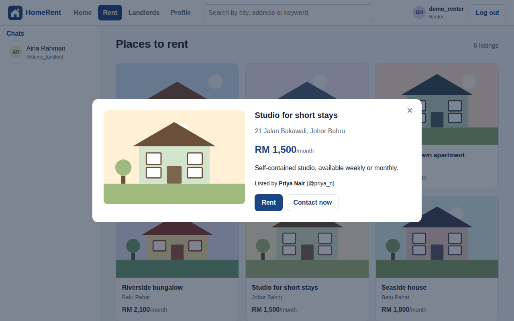

## Overview

The case study is a landlord in Batu Pahat, Johor, who rents rooms and houses to local and international students and workers around Parit Raja. Her main problems were late rent payments and the time spent chasing tenants. The system lets:

- **Renters** search listings by city, address or keyword, view details, rent a property and message the landlord.
- **Landlords** list and remove properties, see every tenant's payment status (paid/unpaid), and send a reminder to all unpaid tenants with one click.
- **Everyone** sign up, log in, edit their profile and chat one-to-one.

Every screen and process in the prototype traces back to the analysis documents:

| DFD process | Page | Report figure |
|---|---|---|
| 1.0 Login account | Login dialog (`index.html`) | 4.3.3.1, 4.3.4.2 |
| 2.0 Sign up account | `signup.html` | 4.3.3.2, 4.3.4.3 |
| 3.0 Search properties | `rent.html` | 4.3.4.5 |
| 4.0 Search landlord | `landlords.html` | 4.3.4.9 |
| 5.0 Rent properties | Property dialog, `rent.html` | 4.3.4.6, 4.3.4.8 |
| 6.0 Chat with landlord/renter | Chat panel (all pages) | 4.3.2.5, 4.3.4.7 |
| 7.0 Edit/add properties | `rent-list.html` | 4.3.4.14, 4.3.4.15 |
| 8.0 Edit profile | `signup.html?mode=edit` | 4.3.4.13 |

## Tech stack

- HTML5, CSS3 (one shared stylesheet, responsive down to phone width)
- Vanilla JavaScript (ES2020), no framework and no build step
- `localStorage` as a client-side database whose tables mirror the ERD
- Node.js built-in test runner (`node --test`) for unit tests, no dependencies
- Playwright (Python) for end-to-end browser tests
- GitHub Actions for CI, GitHub Pages for hosting

## How to run

**Option 1, no install:** download the repo and double-click `index.html`. Everything works from `file://`.

**Option 2, local server:**

```bash
npx serve .            # or: python -m http.server 8000
```

Then open the printed URL.

**Run the tests:**

```bash
npm test                                   # 23 unit tests (Node 18+)
npm run mutation                           # breaks the code 10 ways, checks the tests notice

pip install playwright
python -m playwright install chromium
python tests/e2e/e2e_test.py               # full browser walkthrough
python tests/e2e/e2e_test.py --screenshots # also regenerates docs/screenshots/
```

To start over with the sample data, open **Profile → Reset demo data**.

## Analysis and design

| Context diagram |
|---|
| 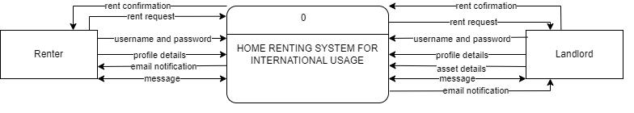 |

| Level-0 DFD | Original ERD |
|---|---|
| 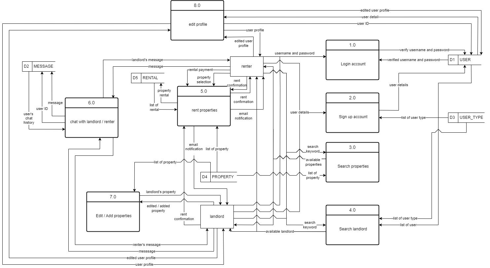 | 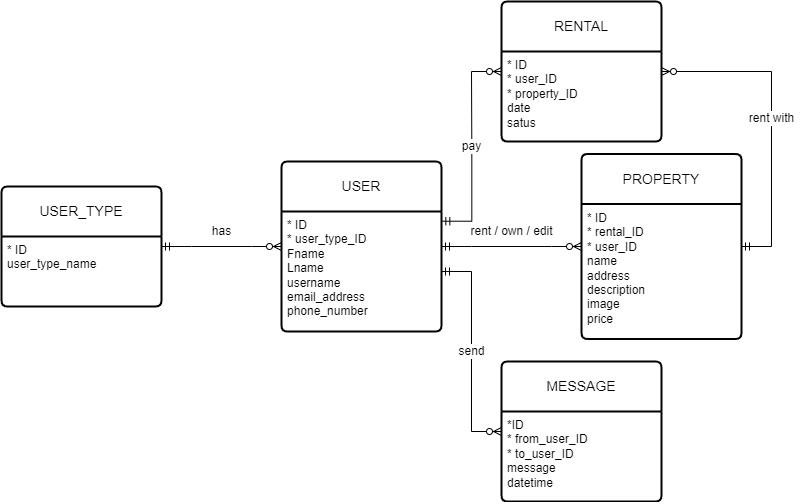 |

### Implemented data model

Building the prototype exposed two problems in the original ERD, which were corrected in the code (`js/store.js`):

1. `USER` had no password attribute, so login could not be modelled. Added `passwordHash`.
2. `PROPERTY` held a `rental_ID` foreign key, which only allows one rental per property and duplicates the link already held by `RENTAL.property_ID`. Removed it.

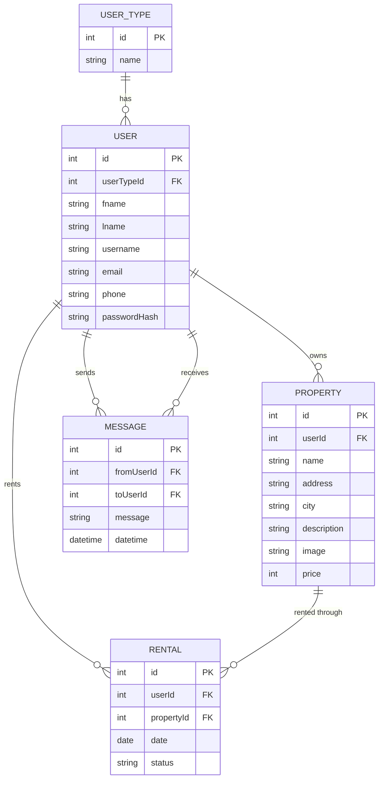

## Results

All flows from the design work end to end. The automated suite covers them:

- **23 unit tests** (`tests/*.test.js`): validation rules and boundaries, login and hashing, search, rent rules, ownership checks, reminders, messaging, persistence across reloads and recovery from corrupted storage.
- **Mutation check** (`scripts/mutation-check.mjs`): deliberately introduces 10 bugs (e.g. login ignores the password, reminders go to tenants who already paid, rent of 0 accepted) and confirms the unit tests fail for each. **10/10 caught.** The first run caught 9/10 and exposed a missing price-boundary test, which was then added.
- **End-to-end test** (`tests/e2e/e2e_test.py`): logs in as each role, searches, rents, chats, edits a profile, signs up a new landlord, adds a property, sends reminders and checks role-based access, failing on any JavaScript error. It also checks that chat input is escaped (no HTML injection).

| Landing page | Log in |
|---|---|
| 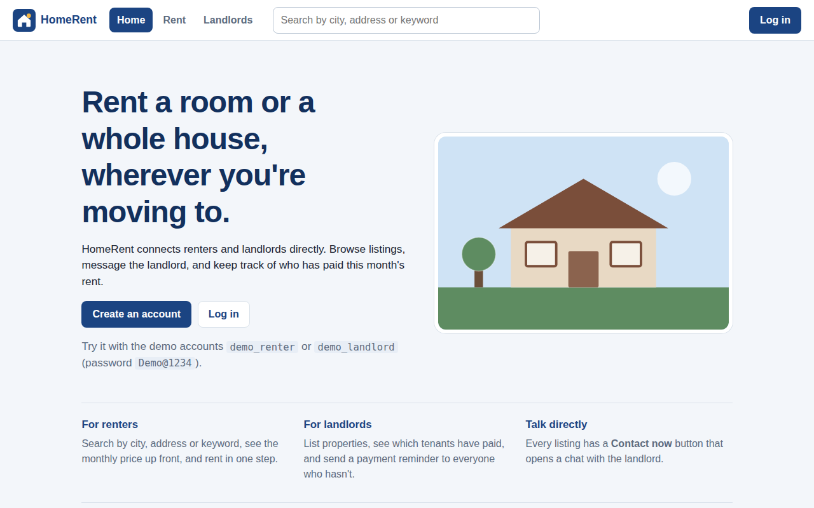 | 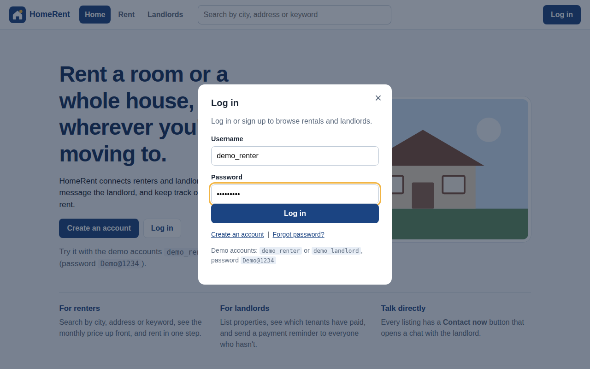 |

| Renter dashboard | Search by city |
|---|---|
| 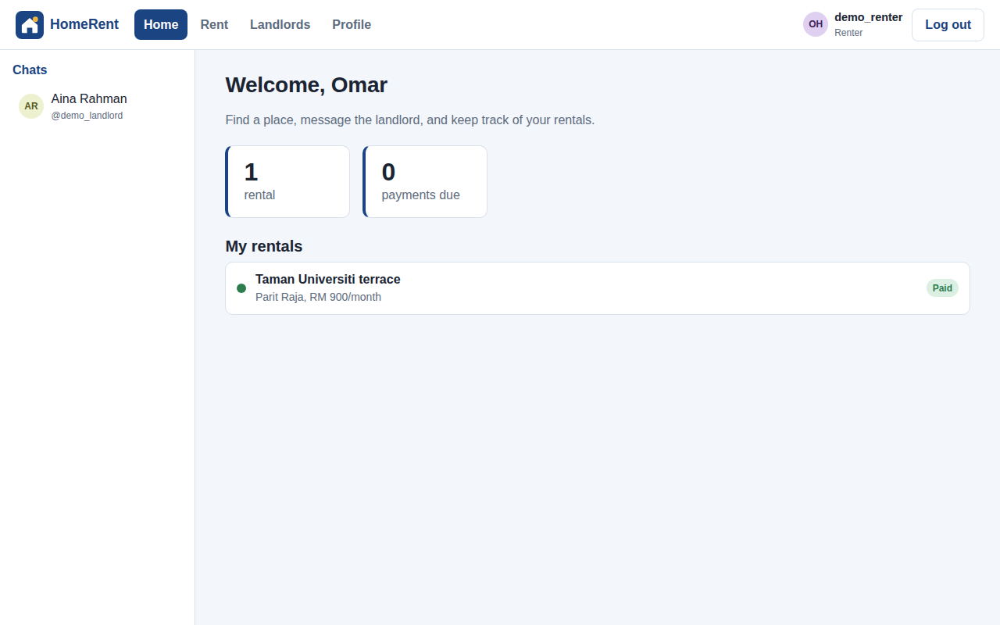 | 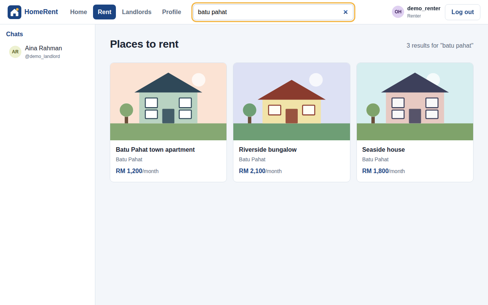 |

| Property details | Chat with the landlord |
|---|---|
|  | 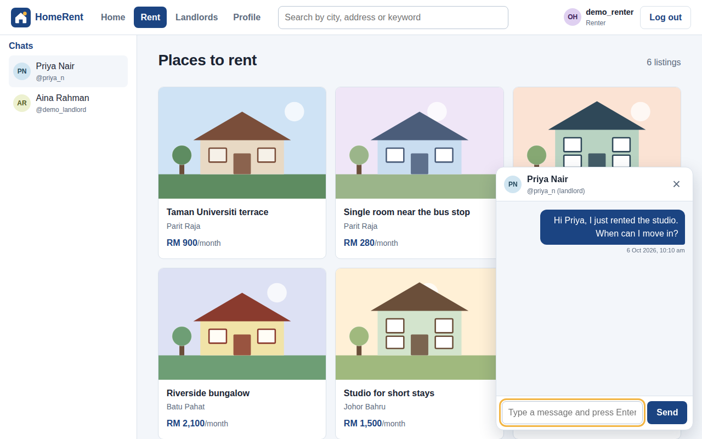 |

| Landlord rent list | Paid/unpaid tenants and reminders |
|---|---|
| 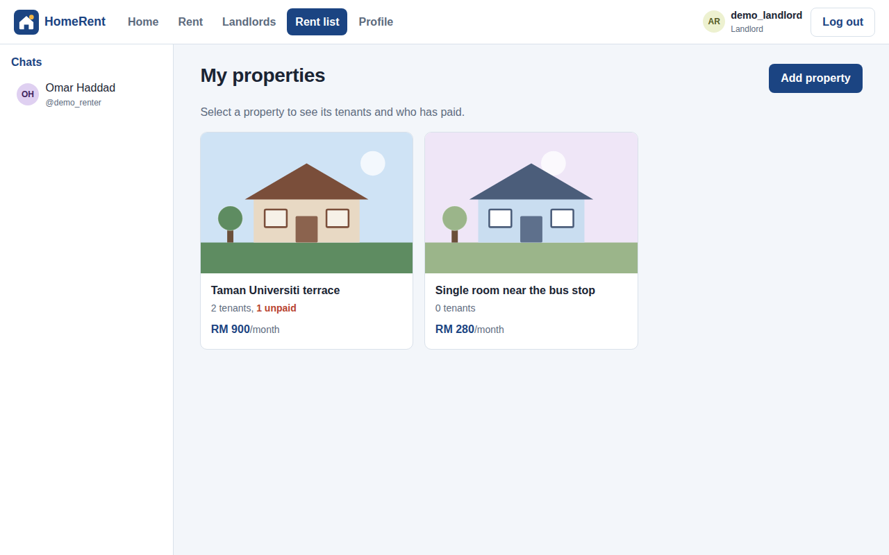 | 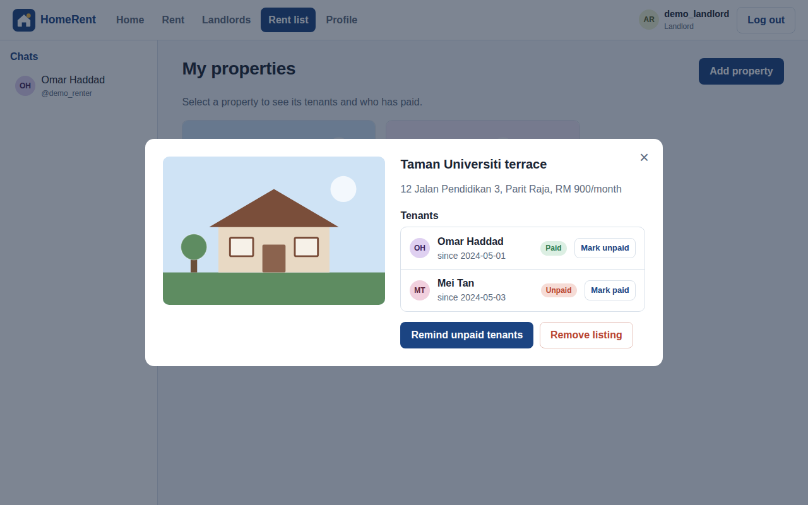 |

| Add a property | |
|---|---|
| 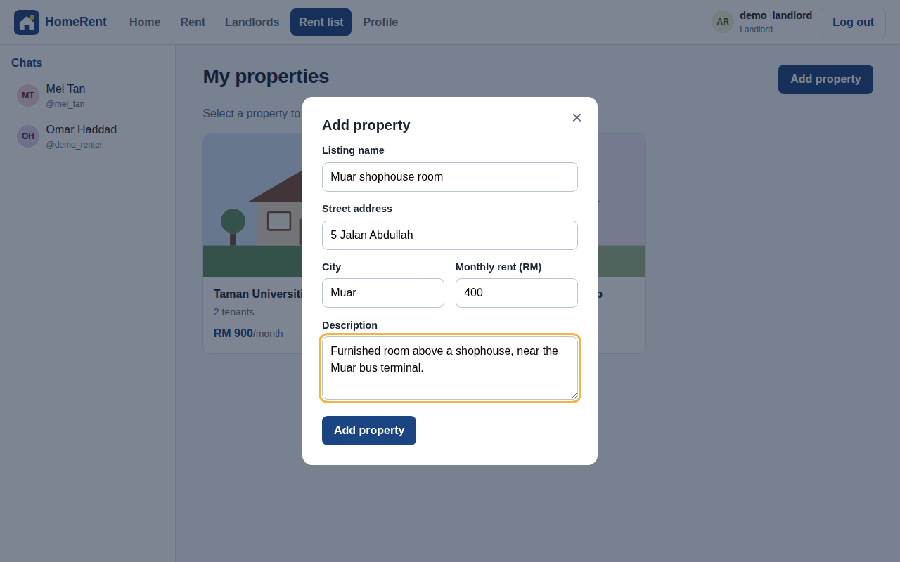 | |

| Sign-up validation | Landlord profile | Mobile |
|---|---|---|
| 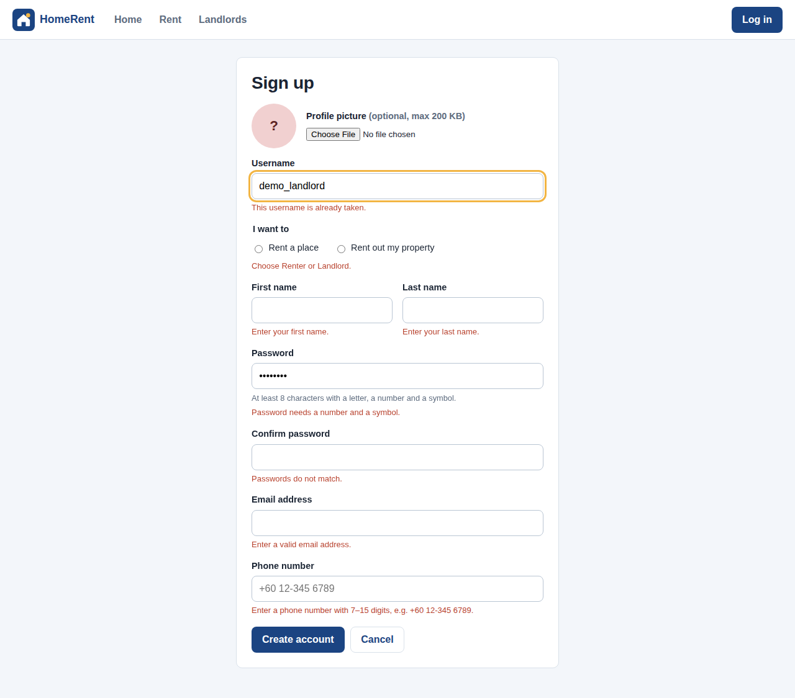 | 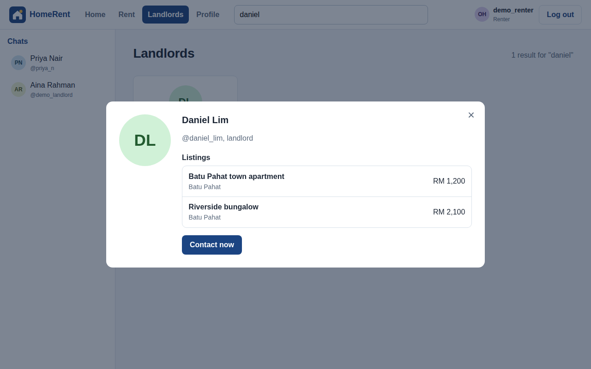 | 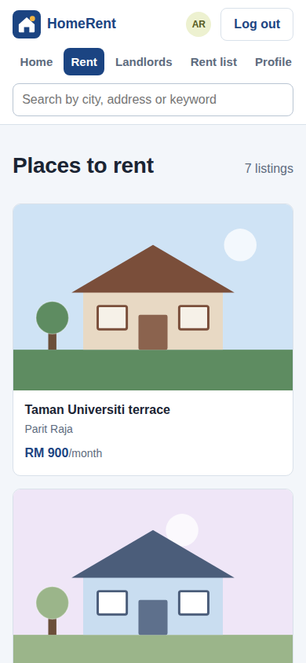 |

## Findings

- **The submitted prototype had 15 reproducible bugs**, including a login that accepted any password and a role that could be changed by editing the URL. Each one, with the input used, is listed in [`docs/original-audit.md`](docs/original-audit.md).
- **Implementing a design is the fastest way to test it.** The ERD looked complete on paper, but the missing password field and the misplaced `rental_ID` key only surfaced when real login and multi-tenant rentals were coded.
- **The landlord's core problem (late payments) is solved by status visibility plus a nudge.** The rent list shows paid/unpaid per tenant, and "Remind unpaid tenants" messages exactly the tenants who still owe rent.
- **Role checks must live in the data layer, not the UI.** The original prototype passed the user role in the URL (`?landlord`), so anyone could reach landlord pages by editing it. Roles now come from the logged-in user's record, and `store.js` refuses actions on properties the user does not own.
- **Shared code removed most of the bugs.** The original repeated the same header, sidebar, chat and navigation code across six pages; moving it into `js/ui.js` cut the duplication and made each page script small enough to read in one screen.

## Limitations

- No server: data lives in one browser's `localStorage`, so two people on different devices cannot chat with each other. The data layer is isolated in `js/store.js` so it can be swapped for API calls.
- Password hashing is a demo-only FNV-1a hash. A real deployment needs server-side hashing (bcrypt/argon2) and HTTPS.
- Online payment, email notifications, map/GPS search and password reset from the report's scope are not implemented. Reminders are sent as in-app chat messages instead of email.
- Group chats from the original mock-up were dropped because the ERD's `MESSAGE` table only supports one-to-one messages.

## Project structure

```
home-renting-system/
├── index.html              # public landing page + login dialog
├── signup.html             # sign up / edit profile (?mode=edit)
├── home.html               # dashboard after login (role-specific)
├── rent.html               # browse, search and rent properties
├── landlords.html          # browse and search landlords
├── rent-list.html          # landlord only: tenants, payment status, add/remove listings
├── profile.html            # user profile, reset demo data
├── css/
│   └── style.css           # single shared stylesheet
├── js/
│   ├── store.js            # data layer (ERD tables in localStorage)
│   ├── validation.js       # form validation rules
│   ├── ui.js               # shared header, chat, modal and toast
│   └── pages/              # one small script per page
├── assets/img/             # logo and property illustrations (SVG)
├── docs/
│   ├── diagrams/           # context diagram, DFD, ERD from the report
│   ├── screenshots/        # generated by the e2e test
│   └── original-audit.md   # bugs reproduced in the submitted version
├── tests/
│   ├── store.test.js
│   ├── validation.test.js
│   └── e2e/e2e_test.py
├── scripts/
│   └── mutation-check.mjs  # verifies the tests catch deliberate bugs
├── .github/workflows/test.yml
├── CHANGELOG.md
├── package.json
├── .gitattributes
└── .gitignore
```

## Credits

Group project for **BIC21003 System Analysis and Design**, Session 2023/2024, Faculty of Computer Science and Information Technology, Universiti Tun Hussein Onn Malaysia (UTHM).

Team members:

- Sani Abdallah Ahmad
- Chai Wen Zun
- Mohammad Hani Hashem Musleh
- Ousman Mahamat Ousman Youssouf
- Musaab Fahmi Fadhl Al-Husaini

### Added after submission (by Musaab Fahmi Fadhl Al-Husaini)

The submitted prototype was a static mock-up: buttons opened pop-ups, but there was no login check, search, data, or saved state. After the course I:

- rebuilt it as a working app on a data layer that follows the ERD, and corrected the two ERD issues above;
- implemented login, sign-up and profile validation (including the report's password rule), search, renting, one-to-one chat, payment status and reminders, and add/remove property;
- replaced six copies of shared code with one stylesheet and shared scripts, fixed invalid HTML (duplicate IDs, buttons inside table rows) and removed unused jQuery/Bootstrap;
- moved role checks from the URL into the data layer and escaped all user input;
- replaced placeholder stock images and logo with original SVG artwork;
- added unit tests, a mutation check, an end-to-end test, CI and screenshots.

Full list: [CHANGELOG.md](CHANGELOG.md).
